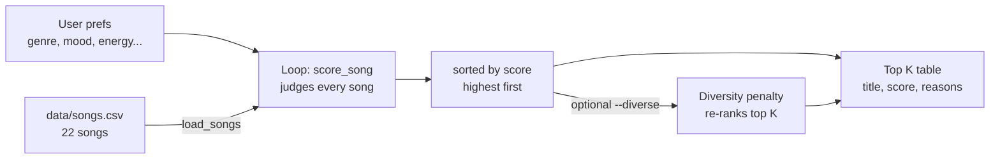

# 🎵 Music Recommender Simulation: VibeFinder 1.0

## Project Summary

VibeFinder 1.0 is a small, explainable, content-based music recommender written in Python. It loads a 22-song catalog from `data/songs.csv`, compares every song to a user's "taste profile" (favorite genre, mood, target energy, and optional extras like mood tags or release decade), gives each song a score with a list of plain-English reasons, and prints the top K songs as a table in the terminal.

Beyond the core project, this version includes all four optional extensions:

| Extension | What was built |
|---|---|
| 1. Advanced song features | 5 new columns: `popularity`, `release_decade`, `mood_tags`, `instrumentalness`, `liveness` (4 are used in scoring) |
| 2. Multiple scoring modes | `balanced`, `genre_first`, `mood_first`, `energy_focused` (+ two experiment modes), switchable with `--mode` |
| 3. Diversity and fairness | `--diverse` penalizes repeated artists (-1.5) and repeated genres (-0.5) in the top results |
| 4. Visual summary table | ASCII table with title, artist, genre/mood, score, and every scoring reason |

---

## How The System Works

**How real recommenders work.** Platforms like Spotify and YouTube mix two big ideas. *Collaborative filtering* looks at behavior: "people who liked the songs you like also liked X." It uses likes, skips, replays, saves, playlist adds, and listening time across millions of users. *Content-based filtering* looks at the songs themselves: genre, tempo, energy, mood, acousticness, and audio fingerprints. Real systems blend both, plus context (time of day, device) and heavy machine learning. Collaborative filtering is powerful but needs lots of users; content-based filtering works from day one but can trap people in a "filter bubble" of songs that all sound alike.

**What VibeFinder prioritizes.** My version is purely content-based, because I only have song attributes and one user at a time. It prioritizes **genre first, mood second, and energy closeness third**, and uses the other features as tie-breakers. Every point it awards is written down as a "reason", so the user can always see *why* a song was suggested.

### Features used

**`Song`** (one row of `songs.csv`):
- `genre`, `mood` (categorical labels)
- `energy`, `valence`, `acousticness`, `instrumentalness` (0.0 to 1.0)
- `popularity` (0 to 100), `release_decade` (e.g. `1980s`), `mood_tags` (e.g. `nostalgic;dreamy`)
- Also stored but not scored: `tempo_bpm`, `danceability`, `liveness`

**`UserProfile`** (or a plain preferences dictionary):
- `favorite_genre`, `favorite_mood`, `target_energy`, `likes_acoustic` (core)
- Optional: `target_valence`, `preferred_mood_tags`, `preferred_decade`, `target_popularity`, `likes_instrumental`

### Algorithm Recipe (balanced mode)

| Rule | Points |
|---|---|
| Genre matches exactly | **+2.0** |
| Mood matches exactly | **+1.0** |
| Energy closeness | **+1.5 × (1 − \|song energy − target energy\|)** |
| Likes acoustic / likes produced sound | +0.5 × acousticness (or × (1 − acousticness)) |
| Valence closeness *(optional)* | +0.5 × (1 − \|difference\|) |
| Each matching mood tag *(optional)* | +0.5 per tag |
| Release decade matches *(optional)* | +0.5 |
| Popularity closeness *(optional)* | +0.5 × (1 − \|difference\| / 100) |
| Likes instrumental / vocals *(optional)* | +0.5 × instrumentalness (or × (1 − instrumentalness)) |

**Why closeness instead of "higher is better"?** A chill listener who wants energy 0.35 should not be rewarded with the loudest song. Using `1 − |song − target|` gives full points for an exact match and fewer points the further away a song is, in either direction.

**Scoring rule vs. ranking rule.** The *scoring rule* (`score_song`) judges one song in isolation and returns a number plus reasons. The *ranking rule* (`recommend_songs`) runs that judge on every song, sorts the whole list from highest to lowest with `sorted()` (which returns a new list and leaves the catalog untouched, unlike `.sort()`, which reorders a list in place), and keeps the top K. You need both: a score alone doesn't tell you what to show first, and a ranking needs scores to compare.

### Data flow



### Expected biases (written before testing)

- The system will probably **over-prioritize genre**: a +2.0 genre match can beat a song that matches the user's mood and energy perfectly.
- Genre matching is exact text, so **"indie pop" gets zero genre credit for a "pop" fan**.
- Users whose favorite genre has only one song in the catalog get **one good match and then filler**.

---

## Getting Started

### Setup

1. Create a virtual environment (optional but recommended):

   ```bash
   python -m venv .venv
   source .venv/bin/activate      # Mac or Linux
   .venv\Scripts\activate         # Windows
   ```

2. Install dependencies

   ```bash
   pip install -r requirements.txt
   ```

3. Run the app:

   ```bash
   python -m src.main                                   # default pop/happy profile
   python -m src.main --profile all                     # every profile
   python -m src.main --profile chill_lofi --mode mood_first
   python -m src.main --diverse                         # diversity penalty on
   python -m src.main --profile edge_sad_but_hyped --compare-modes
   python -m src.main --list                            # list profiles and modes
   ```

### Running Tests

```bash
pytest
```

There are 9 tests in `tests/test_recommender.py`. They cover the OOP `Recommender`, CSV type conversion, the scoring math, closeness-based energy, sorting, scoring modes, the diversity penalty, and the advanced features.

---

## Sample Recommendation Output

Default "pop/happy" profile (`python -m src.main`):

```
Loaded songs: 22

=== Default Pop/Happy (starter profile) ===
Prefs: genre=pop, mood=happy, energy=0.8
Mode: balanced | Diversity penalty: off
+---+-------------------+---------------+-------------------+-------+------------------------------------+
| # | Title             | Artist        | Genre / Mood      | Score | Reasons                            |
+===+===================+===============+===================+=======+====================================+
| 1 | Sunrise City      | Neon Echo     | pop / happy       | 4.47  | genre match: pop (+2.00)           |
|   |                   |               |                   |       | mood match: happy (+1.00)          |
|   |                   |               |                   |       | energy 0.82 vs target 0.80 (+1.47) |
+---+-------------------+---------------+-------------------+-------+------------------------------------+
| 2 | Neon Heartbeat    | Max Pulse     | pop / happy       | 4.38  | genre match: pop (+2.00)           |
|   |                   |               |                   |       | mood match: happy (+1.00)          |
|   |                   |               |                   |       | energy 0.88 vs target 0.80 (+1.38) |
+---+-------------------+---------------+-------------------+-------+------------------------------------+
| 3 | Golden Hour Drive | Neon Echo     | pop / happy       | 4.35  | genre match: pop (+2.00)           |
|   |                   |               |                   |       | mood match: happy (+1.00)          |
|   |                   |               |                   |       | energy 0.70 vs target 0.80 (+1.35) |
+---+-------------------+---------------+-------------------+-------+------------------------------------+
| 4 | Gym Hero          | Max Pulse     | pop / intense     | 3.31  | genre match: pop (+2.00)           |
|   |                   |               |                   |       | energy 0.93 vs target 0.80 (+1.30) |
+---+-------------------+---------------+-------------------+-------+------------------------------------+
| 5 | Rooftop Lights    | Indigo Parade | indie pop / happy | 2.44  | mood match: happy (+1.00)          |
|   |                   |               |                   |       | energy 0.76 vs target 0.80 (+1.44) |
+---+-------------------+---------------+-------------------+-------+------------------------------------+
```

The top three are all pop + happy songs with energy near 0.8, which is exactly what I'd expect. **Gym Hero** sneaks into 4th: it is pop and high-energy, but its mood is "intense", not "happy". In plain language, it collects the big genre bonus and almost all of the energy points, so it still beats every non-pop song even without the mood point.

---

## Stress Test Output (All Profiles)

I tested 4 core profiles, 1 profile that uses the advanced features, and 4 adversarial "edge case" profiles. All runs use balanced mode, diversity off, top 5.

### Default Pop/Happy (starter profile)

`python -m src.main --profile pop_happy`

```
Loaded songs: 22

=== Default Pop/Happy (starter profile) ===
Prefs: genre=pop, mood=happy, energy=0.8
Mode: balanced | Diversity penalty: off
+---+-------------------+---------------+-------------------+-------+------------------------------------+
| # | Title             | Artist        | Genre / Mood      | Score | Reasons                            |
+===+===================+===============+===================+=======+====================================+
| 1 | Sunrise City      | Neon Echo     | pop / happy       | 4.47  | genre match: pop (+2.00)           |
|   |                   |               |                   |       | mood match: happy (+1.00)          |
|   |                   |               |                   |       | energy 0.82 vs target 0.80 (+1.47) |
+---+-------------------+---------------+-------------------+-------+------------------------------------+
| 2 | Neon Heartbeat    | Max Pulse     | pop / happy       | 4.38  | genre match: pop (+2.00)           |
|   |                   |               |                   |       | mood match: happy (+1.00)          |
|   |                   |               |                   |       | energy 0.88 vs target 0.80 (+1.38) |
+---+-------------------+---------------+-------------------+-------+------------------------------------+
| 3 | Golden Hour Drive | Neon Echo     | pop / happy       | 4.35  | genre match: pop (+2.00)           |
|   |                   |               |                   |       | mood match: happy (+1.00)          |
|   |                   |               |                   |       | energy 0.70 vs target 0.80 (+1.35) |
+---+-------------------+---------------+-------------------+-------+------------------------------------+
| 4 | Gym Hero          | Max Pulse     | pop / intense     | 3.31  | genre match: pop (+2.00)           |
|   |                   |               |                   |       | energy 0.93 vs target 0.80 (+1.30) |
+---+-------------------+---------------+-------------------+-------+------------------------------------+
| 5 | Rooftop Lights    | Indigo Parade | indie pop / happy | 2.44  | mood match: happy (+1.00)          |
|   |                   |               |                   |       | energy 0.76 vs target 0.80 (+1.44) |
+---+-------------------+---------------+-------------------+-------+------------------------------------+
```

### High-Energy Pop

`python -m src.main --profile high_energy_pop`

```
Loaded songs: 22

=== High-Energy Pop ===
Prefs: genre=pop, mood=happy, energy=0.9, likes_acoustic=False
Mode: balanced | Diversity penalty: off
+---+-------------------+---------------+-------------------+-------+------------------------------------+
| # | Title             | Artist        | Genre / Mood      | Score | Reasons                            |
+===+===================+===============+===================+=======+====================================+
| 1 | Neon Heartbeat    | Max Pulse     | pop / happy       | 4.93  | genre match: pop (+2.00)           |
|   |                   |               |                   |       | mood match: happy (+1.00)          |
|   |                   |               |                   |       | energy 0.88 vs target 0.90 (+1.47) |
|   |                   |               |                   |       | produced/electric sound (+0.46)    |
+---+-------------------+---------------+-------------------+-------+------------------------------------+
| 2 | Sunrise City      | Neon Echo     | pop / happy       | 4.79  | genre match: pop (+2.00)           |
|   |                   |               |                   |       | mood match: happy (+1.00)          |
|   |                   |               |                   |       | energy 0.82 vs target 0.90 (+1.38) |
|   |                   |               |                   |       | produced/electric sound (+0.41)    |
+---+-------------------+---------------+-------------------+-------+------------------------------------+
| 3 | Golden Hour Drive | Neon Echo     | pop / happy       | 4.58  | genre match: pop (+2.00)           |
|   |                   |               |                   |       | mood match: happy (+1.00)          |
|   |                   |               |                   |       | energy 0.70 vs target 0.90 (+1.20) |
|   |                   |               |                   |       | produced/electric sound (+0.38)    |
+---+-------------------+---------------+-------------------+-------+------------------------------------+
| 4 | Gym Hero          | Max Pulse     | pop / intense     | 3.93  | genre match: pop (+2.00)           |
|   |                   |               |                   |       | energy 0.93 vs target 0.90 (+1.46) |
|   |                   |               |                   |       | produced/electric sound (+0.47)    |
+---+-------------------+---------------+-------------------+-------+------------------------------------+
| 5 | Rooftop Lights    | Indigo Parade | indie pop / happy | 2.62  | mood match: happy (+1.00)          |
|   |                   |               |                   |       | energy 0.76 vs target 0.90 (+1.29) |
|   |                   |               |                   |       | produced/electric sound (+0.33)    |
+---+-------------------+---------------+-------------------+-------+------------------------------------+
```

### Chill Lofi

`python -m src.main --profile chill_lofi`

```
Loaded songs: 22

=== Chill Lofi ===
Prefs: genre=lofi, mood=chill, energy=0.35, likes_acoustic=True, likes_instrumental=True
Mode: balanced | Diversity penalty: off
+---+----------------------+----------------+-------------------------+-------+------------------------------------+
| # | Title                | Artist         | Genre / Mood            | Score | Reasons                            |
+===+======================+================+=========================+=======+====================================+
| 1 | Library Rain         | Paper Lanterns | lofi / chill            | 5.38  | genre match: lofi (+2.00)          |
|   |                      |                |                         |       | mood match: chill (+1.00)          |
|   |                      |                |                         |       | energy 0.35 vs target 0.35 (+1.50) |
|   |                      |                |                         |       | acoustic sound (+0.43)             |
|   |                      |                |                         |       | instrumental (+0.45)               |
+---+----------------------+----------------+-------------------------+-------+------------------------------------+
| 2 | Midnight Coding      | LoRoom         | lofi / chill            | 5.17  | genre match: lofi (+2.00)          |
|   |                      |                |                         |       | mood match: chill (+1.00)          |
|   |                      |                |                         |       | energy 0.42 vs target 0.35 (+1.40) |
|   |                      |                |                         |       | acoustic sound (+0.35)             |
|   |                      |                |                         |       | instrumental (+0.42)               |
+---+----------------------+----------------+-------------------------+-------+------------------------------------+
| 3 | Focus Flow           | LoRoom         | lofi / focused          | 4.25  | genre match: lofi (+2.00)          |
|   |                      |                |                         |       | energy 0.40 vs target 0.35 (+1.42) |
|   |                      |                |                         |       | acoustic sound (+0.39)             |
|   |                      |                |                         |       | instrumental (+0.44)               |
+---+----------------------+----------------+-------------------------+-------+------------------------------------+
| 4 | Spacewalk Thoughts   | Orbit Bloom    | ambient / chill         | 3.33  | mood match: chill (+1.00)          |
|   |                      |                |                         |       | energy 0.28 vs target 0.35 (+1.40) |
|   |                      |                |                         |       | acoustic sound (+0.46)             |
|   |                      |                |                         |       | instrumental (+0.47)               |
+---+----------------------+----------------+-------------------------+-------+------------------------------------+
| 5 | Moonlit Sonata Redux | Clara Vale     | classical / melancholic | 2.28  | energy 0.22 vs target 0.35 (+1.30) |
|   |                      |                |                         |       | acoustic sound (+0.48)             |
|   |                      |                |                         |       | instrumental (+0.49)               |
+---+----------------------+----------------+-------------------------+-------+------------------------------------+
```

### Deep Intense Rock

`python -m src.main --profile deep_intense_rock`

```
Loaded songs: 22

=== Deep Intense Rock ===
Prefs: genre=rock, mood=intense, energy=0.9, likes_acoustic=False
Mode: balanced | Diversity penalty: off
+---+----------------+--------------+----------------+-------+------------------------------------+
| # | Title          | Artist       | Genre / Mood   | Score | Reasons                            |
+===+================+==============+================+=======+====================================+
| 1 | Storm Runner   | Voltline     | rock / intense | 4.93  | genre match: rock (+2.00)          |
|   |                |              |                |       | mood match: intense (+1.00)        |
|   |                |              |                |       | energy 0.91 vs target 0.90 (+1.48) |
|   |                |              |                |       | produced/electric sound (+0.45)    |
+---+----------------+--------------+----------------+-------+------------------------------------+
| 2 | Gym Hero       | Max Pulse    | pop / intense  | 2.93  | mood match: intense (+1.00)        |
|   |                |              |                |       | energy 0.93 vs target 0.90 (+1.46) |
|   |                |              |                |       | produced/electric sound (+0.47)    |
+---+----------------+--------------+----------------+-------+------------------------------------+
| 3 | Neon Heartbeat | Max Pulse    | pop / happy    | 1.93  | energy 0.88 vs target 0.90 (+1.47) |
|   |                |              |                |       | produced/electric sound (+0.46)    |
+---+----------------+--------------+----------------+-------+------------------------------------+
| 4 | Laser Bloom    | Pulse Theory | edm / euphoric | 1.92  | energy 0.95 vs target 0.90 (+1.43) |
|   |                |              |                |       | produced/electric sound (+0.49)    |
+---+----------------+--------------+----------------+-------+------------------------------------+
| 5 | Iron Tempest   | Grave Signal | metal / angry  | 1.88  | energy 0.97 vs target 0.90 (+1.40) |
|   |                |              |                |       | produced/electric sound (+0.48)    |
+---+----------------+--------------+----------------+-------+------------------------------------+
```

### Nostalgic Night Drive (uses advanced features)

`python -m src.main --profile nostalgic_night_drive`

```
Loaded songs: 22

=== Nostalgic Night Drive (uses advanced features) ===
Prefs: genre=synthwave, mood=moody, energy=0.65, mood_tags=nostalgic/dreamy, decade=1980s, popularity=50, valence=0.5
Mode: balanced | Diversity penalty: off
+---+--------------------+----------------+---------------------+-------+--------------------------------------+
| # | Title              | Artist         | Genre / Mood        | Score | Reasons                              |
+===+====================+================+=====================+=======+======================================+
| 1 | Night Drive Loop   | Neon Echo      | synthwave / moody   | 6.79  | genre match: synthwave (+2.00)       |
|   |                    |                |                     |       | mood match: moody (+1.00)            |
|   |                    |                |                     |       | energy 0.75 vs target 0.65 (+1.35)   |
|   |                    |                |                     |       | valence 0.49 vs target 0.50 (+0.49)  |
|   |                    |                |                     |       | mood tags: nostalgic, dreamy (+1.00) |
|   |                    |                |                     |       | from the 1980s (+0.50)               |
|   |                    |                |                     |       | popularity 60 vs target 50 (+0.45)   |
+---+--------------------+----------------+---------------------+-------+--------------------------------------+
| 2 | Dusty Porch Swing  | Willow Creek   | country / nostalgic | 2.70  | energy 0.55 vs target 0.65 (+1.35)   |
|   |                    |                |                     |       | valence 0.72 vs target 0.50 (+0.39)  |
|   |                    |                |                     |       | mood tags: nostalgic (+0.50)         |
|   |                    |                |                     |       | popularity 58 vs target 50 (+0.46)   |
+---+--------------------+----------------+---------------------+-------+--------------------------------------+
| 3 | Golden Hour Drive  | Neon Echo      | pop / happy         | 2.69  | energy 0.70 vs target 0.65 (+1.43)   |
|   |                    |                |                     |       | valence 0.80 vs target 0.50 (+0.35)  |
|   |                    |                |                     |       | mood tags: nostalgic (+0.50)         |
|   |                    |                |                     |       | popularity 66 vs target 50 (+0.42)   |
+---+--------------------+----------------+---------------------+-------+--------------------------------------+
| 4 | Library Rain       | Paper Lanterns | lofi / chill        | 2.49  | energy 0.35 vs target 0.65 (+1.05)   |
|   |                    |                |                     |       | valence 0.60 vs target 0.50 (+0.45)  |
|   |                    |                |                     |       | mood tags: nostalgic (+0.50)         |
|   |                    |                |                     |       | popularity 48 vs target 50 (+0.49)   |
+---+--------------------+----------------+---------------------+-------+--------------------------------------+
| 5 | Spacewalk Thoughts | Orbit Bloom    | ambient / chill     | 2.29  | energy 0.28 vs target 0.65 (+0.95)   |
|   |                    |                |                     |       | valence 0.65 vs target 0.50 (+0.42)  |
|   |                    |                |                     |       | mood tags: dreamy (+0.50)            |
|   |                    |                |                     |       | popularity 35 vs target 50 (+0.42)   |
+---+--------------------+----------------+---------------------+-------+--------------------------------------+
```

### EDGE: Sad but Hyped (energy 0.9 + mood sad)

`python -m src.main --profile edge_sad_but_hyped`

```
Loaded songs: 22

=== EDGE: Sad but Hyped (energy 0.9 + mood sad) ===
Prefs: genre=edm, mood=sad, energy=0.9
Mode: balanced | Diversity penalty: off
+---+----------------+-------------------+----------------+-------+------------------------------------+
| # | Title          | Artist            | Genre / Mood   | Score | Reasons                            |
+===+================+===================+================+=======+====================================+
| 1 | Laser Bloom    | Pulse Theory      | edm / euphoric | 3.42  | genre match: edm (+2.00)           |
|   |                |                   |                |       | energy 0.95 vs target 0.90 (+1.43) |
+---+----------------+-------------------+----------------+-------+------------------------------------+
| 2 | Delta Midnight | Muddy Rivers Trio | blues / sad    | 1.82  | mood match: sad (+1.00)            |
|   |                |                   |                |       | energy 0.45 vs target 0.90 (+0.83) |
+---+----------------+-------------------+----------------+-------+------------------------------------+
| 3 | Paper Boats    | Hollow Pines      | folk / sad     | 1.60  | mood match: sad (+1.00)            |
|   |                |                   |                |       | energy 0.30 vs target 0.90 (+0.60) |
+---+----------------+-------------------+----------------+-------+------------------------------------+
| 4 | Storm Runner   | Voltline          | rock / intense | 1.49  | energy 0.91 vs target 0.90 (+1.48) |
+---+----------------+-------------------+----------------+-------+------------------------------------+
| 5 | Neon Heartbeat | Max Pulse         | pop / happy    | 1.47  | energy 0.88 vs target 0.90 (+1.47) |
+---+----------------+-------------------+----------------+-------+------------------------------------+
```

### EDGE: Genre not in catalog (k-pop)

`python -m src.main --profile edge_unknown_genre`

```
Loaded songs: 22

=== EDGE: Genre not in catalog (k-pop) ===
Prefs: genre=k-pop, mood=happy, energy=0.6
Mode: balanced | Diversity penalty: off
+---+----------------------+---------------+-------------------+-------+------------------------------------+
| # | Title                | Artist        | Genre / Mood      | Score | Reasons                            |
+===+======================+===============+===================+=======+====================================+
| 1 | Golden Hour Drive    | Neon Echo     | pop / happy       | 2.35  | mood match: happy (+1.00)          |
|   |                      |               |                   |       | energy 0.70 vs target 0.60 (+1.35) |
+---+----------------------+---------------+-------------------+-------+------------------------------------+
| 2 | Rooftop Lights       | Indigo Parade | indie pop / happy | 2.26  | mood match: happy (+1.00)          |
|   |                      |               |                   |       | energy 0.76 vs target 0.60 (+1.26) |
+---+----------------------+---------------+-------------------+-------+------------------------------------+
| 3 | Sunrise City         | Neon Echo     | pop / happy       | 2.17  | mood match: happy (+1.00)          |
|   |                      |               |                   |       | energy 0.82 vs target 0.60 (+1.17) |
+---+----------------------+---------------+-------------------+-------+------------------------------------+
| 4 | Neon Heartbeat       | Max Pulse     | pop / happy       | 2.08  | mood match: happy (+1.00)          |
|   |                      |               |                   |       | energy 0.88 vs target 0.60 (+1.08) |
+---+----------------------+---------------+-------------------+-------+------------------------------------+
| 5 | Island Breeze Riddim | Sol Kingston  | reggae / relaxed  | 1.47  | energy 0.58 vs target 0.60 (+1.47) |
+---+----------------------+---------------+-------------------+-------+------------------------------------+
```

### EDGE: Acoustic-loving Metalhead

`python -m src.main --profile edge_acoustic_metalhead`

```
Loaded songs: 22

=== EDGE: Acoustic-loving Metalhead ===
Prefs: genre=metal, mood=angry, energy=0.95, likes_acoustic=True
Mode: balanced | Diversity penalty: off
+---+----------------+--------------+----------------+-------+------------------------------------+
| # | Title          | Artist       | Genre / Mood   | Score | Reasons                            |
+===+================+==============+================+=======+====================================+
| 1 | Iron Tempest   | Grave Signal | metal / angry  | 4.49  | genre match: metal (+2.00)         |
|   |                |              |                |       | mood match: angry (+1.00)          |
|   |                |              |                |       | energy 0.97 vs target 0.95 (+1.47) |
|   |                |              |                |       | acoustic sound (+0.01)             |
+---+----------------+--------------+----------------+-------+------------------------------------+
| 2 | Laser Bloom    | Pulse Theory | edm / euphoric | 1.51  | energy 0.95 vs target 0.95 (+1.50) |
|   |                |              |                |       | acoustic sound (+0.01)             |
+---+----------------+--------------+----------------+-------+------------------------------------+
| 3 | Gym Hero       | Max Pulse    | pop / intense  | 1.50  | energy 0.93 vs target 0.95 (+1.47) |
|   |                |              |                |       | acoustic sound (+0.03)             |
+---+----------------+--------------+----------------+-------+------------------------------------+
| 4 | Storm Runner   | Voltline     | rock / intense | 1.49  | energy 0.91 vs target 0.95 (+1.44) |
|   |                |              |                |       | acoustic sound (+0.05)             |
+---+----------------+--------------+----------------+-------+------------------------------------+
| 5 | Neon Heartbeat | Max Pulse    | pop / happy    | 1.44  | energy 0.88 vs target 0.95 (+1.40) |
|   |                |              |                |       | acoustic sound (+0.04)             |
+---+----------------+--------------+----------------+-------+------------------------------------+
```

### EDGE: Energy only (no genre or mood)

`python -m src.main --profile edge_energy_only`

```
Loaded songs: 22

=== EDGE: Energy only (no genre or mood) ===
Prefs: energy=0.5
Mode: balanced | Diversity penalty: off
+---+----------------------+-------------------+---------------------+-------+------------------------------------+
| # | Title                | Artist            | Genre / Mood        | Score | Reasons                            |
+===+======================+===================+=====================+=======+====================================+
| 1 | Velvet Hours         | Jade Monroe       | r&b / romantic      | 1.47  | energy 0.52 vs target 0.50 (+1.47) |
+---+----------------------+-------------------+---------------------+-------+------------------------------------+
| 2 | Dusty Porch Swing    | Willow Creek      | country / nostalgic | 1.43  | energy 0.55 vs target 0.50 (+1.42) |
+---+----------------------+-------------------+---------------------+-------+------------------------------------+
| 3 | Delta Midnight       | Muddy Rivers Trio | blues / sad         | 1.43  | energy 0.45 vs target 0.50 (+1.42) |
+---+----------------------+-------------------+---------------------+-------+------------------------------------+
| 4 | Midnight Coding      | LoRoom            | lofi / chill        | 1.38  | energy 0.42 vs target 0.50 (+1.38) |
+---+----------------------+-------------------+---------------------+-------+------------------------------------+
| 5 | Island Breeze Riddim | Sol Kingston      | reggae / relaxed    | 1.38  | energy 0.58 vs target 0.50 (+1.38) |
+---+----------------------+-------------------+---------------------+-------+------------------------------------+
```

---

## Experiments You Tried

### Experiment 1: Weight shift (energy ×2, genre ÷2)

`--mode exp_weight_shift` sets genre to 1.0 and energy to 3.0. The math stays valid: the maximum for genre + mood + energy goes from 4.5 to 5.0, and every term is still non-negative.

- **Pop/Happy, Chill Lofi:** the top songs did not change. The right answers already matched on genre, mood, *and* energy.
- **Deep Intense Rock:** Gym Hero closed the gap with Storm Runner (from 2.93 vs 4.93 to 4.38 vs 5.42). A gym pop song now looks almost as good as real rock.
- **Nostalgic Night Drive:** Golden Hour Drive (a happy pop song) jumped from 3rd to 2nd, just because its energy is close.

**Verdict:** the change made results *different*, not more accurate. Energy is a weak signal of "vibe" by itself, because lots of very different songs share the same energy.

### Experiment 2: Feature removal (no mood check)

`--mode exp_no_mood` sets the mood weight to 0.

- **High-Energy Pop:** Gym Hero (pop / *intense*) tied Neon Heartbeat for 1st place at 3.93 and was listed first. Without the mood check, the system can't tell "happy workout pop" from "aggressive workout pop".
- **Chill Lofi:** Focus Flow (lofi / *focused*) moved ahead of Midnight Coding (lofi / *chill*).
- **k-pop edge case:** the happy pop songs vanished entirely and were replaced by reggae and country tracks that only match on energy.

**Verdict:** mood is pulling its weight. Removing it made results worse for every profile that had a mood.

### Experiment 3: Scoring modes on a conflicting profile

Profile `edge_sad_but_hyped` (edm, sad, energy 0.9), top result per mode:

| Mode | #1 song | Why |
|---|---|---|
| balanced | Laser Bloom (edm / euphoric) | Genre +2.0 beats mood +1.0 |
| genre_first | Laser Bloom (edm / euphoric) | Genre +4.0 dominates |
| mood_first | Delta Midnight (blues / sad) | Mood +3.0 dominates, low energy ignored |
| energy_focused | Laser Bloom, then Storm Runner, Neon Heartbeat | Anything around 0.9 energy |

No single mode satisfies this user, because the catalog has no high-energy sad song. The mode decides *which* half of the request gets ignored.

### Experiment 4: Diversity penalty

`python -m src.main --diverse` on the default profile:

```
Loaded songs: 22

=== Default Pop/Happy (starter profile) ===
Prefs: genre=pop, mood=happy, energy=0.8
Mode: balanced | Diversity penalty: on
+---+-------------------+---------------+---------------------+-------+--------------------------------------------------------------+
| # | Title             | Artist        | Genre / Mood        | Score | Reasons                                                      |
+===+===================+===============+=====================+=======+==============================================================+
| 1 | Sunrise City      | Neon Echo     | pop / happy         | 4.47  | genre match: pop (+2.00)                                     |
|   |                   |               |                     |       | mood match: happy (+1.00)                                    |
|   |                   |               |                     |       | energy 0.82 vs target 0.80 (+1.47)                           |
+---+-------------------+---------------+---------------------+-------+--------------------------------------------------------------+
| 2 | Neon Heartbeat    | Max Pulse     | pop / happy         | 3.88  | genre match: pop (+2.00)                                     |
|   |                   |               |                     |       | mood match: happy (+1.00)                                    |
|   |                   |               |                     |       | energy 0.88 vs target 0.80 (+1.38)                           |
|   |                   |               |                     |       | diversity penalty: genre repeat x1 (-0.50)                   |
+---+-------------------+---------------+---------------------+-------+--------------------------------------------------------------+
| 3 | Rooftop Lights    | Indigo Parade | indie pop / happy   | 2.44  | mood match: happy (+1.00)                                    |
|   |                   |               |                     |       | energy 0.76 vs target 0.80 (+1.44)                           |
+---+-------------------+---------------+---------------------+-------+--------------------------------------------------------------+
| 4 | Golden Hour Drive | Neon Echo     | pop / happy         | 1.85  | genre match: pop (+2.00)                                     |
|   |                   |               |                     |       | mood match: happy (+1.00)                                    |
|   |                   |               |                     |       | energy 0.70 vs target 0.80 (+1.35)                           |
|   |                   |               |                     |       | diversity penalty: artist repeat x1, genre repeat x2 (-2.50) |
+---+-------------------+---------------+---------------------+-------+--------------------------------------------------------------+
| 5 | Concrete Crown    | Verse Theory  | hip hop / confident | 1.47  | energy 0.78 vs target 0.80 (+1.47)                           |
+---+-------------------+---------------+---------------------+-------+--------------------------------------------------------------+
```

Without the penalty, the top 3 has Neon Echo twice and the top 4 is all pop. With it, Golden Hour Drive (repeat artist and 3rd pop song, -2.50) drops to 4th. Rooftop Lights (indie pop) and Concrete Crown (hip hop) get in. Each penalty is shown as its own reason line, so the user can see why a song was moved.

---

## Limitations and Risks

- **Tiny catalog.** 22 songs; 15 of 17 genres have only one song, so many users get one good match and then filler.
- **Genre dominates.** A +2.0 exact-genre bonus outweighs everything else; conflicting requests are resolved by genre.
- **Exact label matching.** "indie pop" ≠ "pop", "chill" ≠ "relaxed". Similar labels earn nothing.
- **No listening history.** It can't learn from skips, likes, or replays, and every user is treated as a single fixed profile.
- **Some preferences are almost powerless.** The "acoustic metalhead" gets nearly 0 acoustic points because every high-energy song in the catalog is electric.
- **Made-up data.** The songs and their numbers were generated for the class, so they may not reflect how real tracks sound.

See the [Model Card](model_card.md) for the full bias analysis.

---

## Reflection

Read the full write-up in the [**Model Card**](model_card.md).

Building VibeFinder showed me that a recommendation is really just a **score plus a sort**. Data goes in (song attributes and a user's stated preferences), a scoring rule turns each pair into a number, and a ranking rule picks the top few. The "intelligence" lives almost entirely in the weights. Changing one number, like doubling energy or removing mood, visibly changed who got recommended what. Even this very simple formula *felt* like a real recommender when the top results were right, and the reasons list made it feel trustworthy.

It also showed me where unfairness comes from. Nothing in the code says "prefer pop", but pop has the most songs in the catalog, so pop fans get five strong matches while a blues or k-pop fan gets one match or none. The genre weight decides conflicts silently, and a user with an unusual combination (sad but high-energy, or acoustic metal) gets results that ignore half of what they asked for. In a real app with millions of users, those same small design choices would decide which artists get heard. That's why documenting the weights and testing edge cases matters as much as writing the code.
